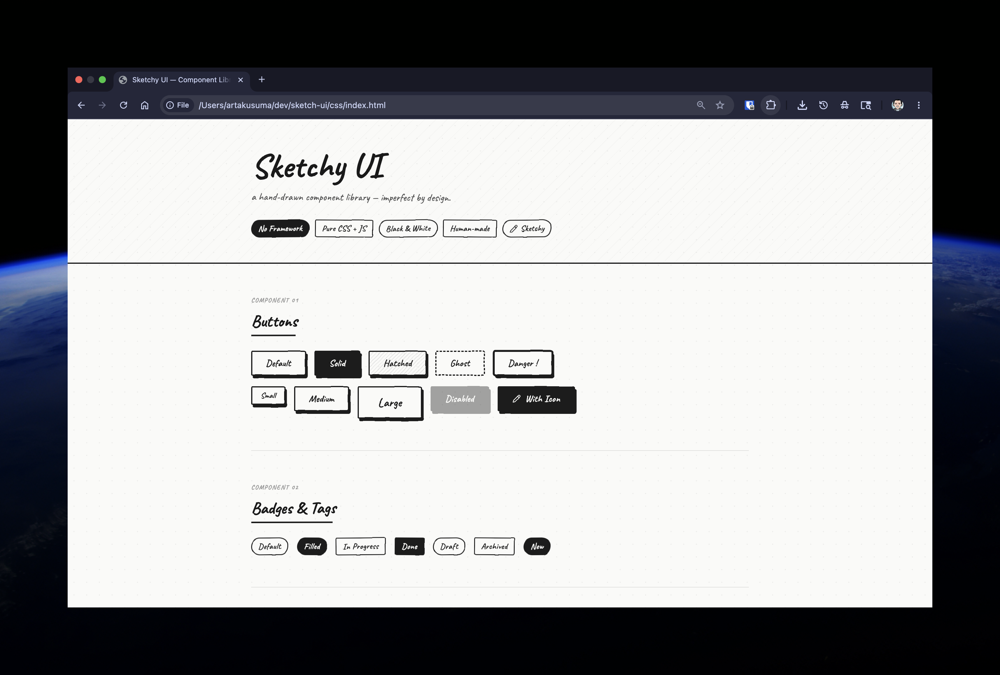
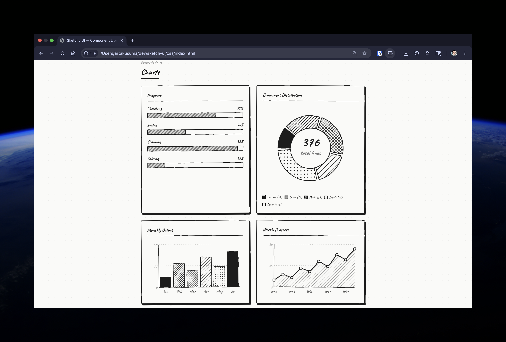
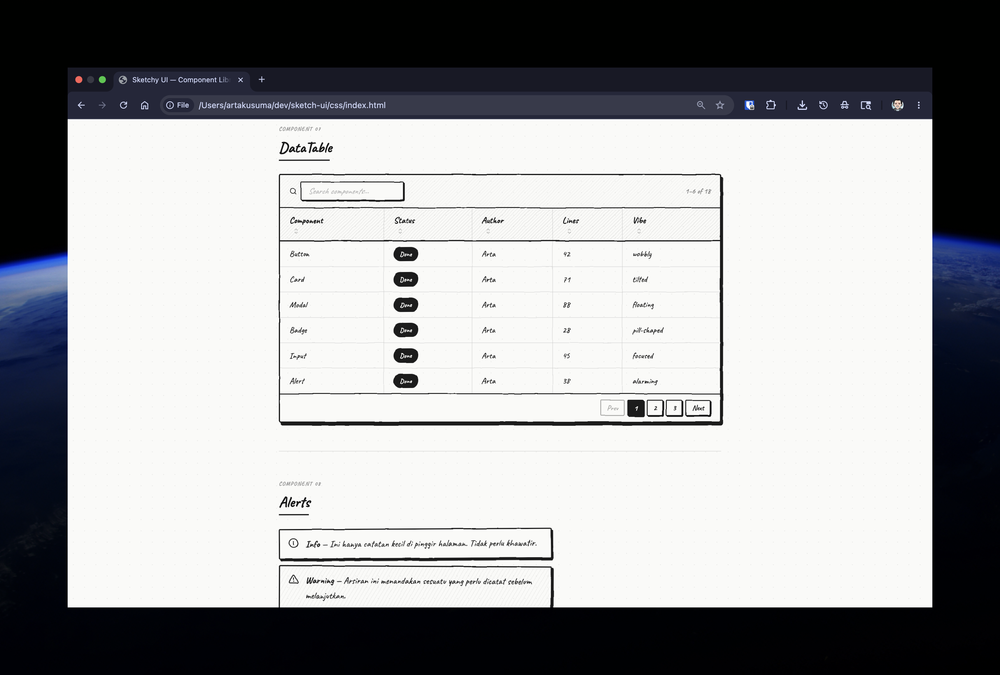
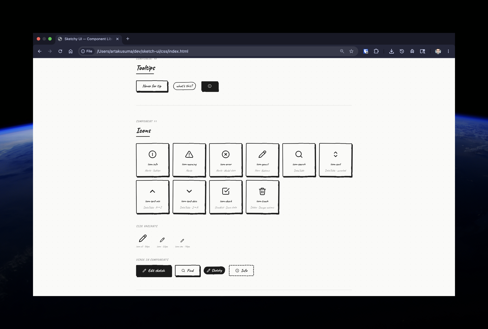

# Sketchy UI

> A hand-drawn component library. Imperfect by design.

Sketchy UI is an open-source UI component library built entirely with **pure HTML and CSS** — no framework, no build step, no dependencies. Every element is crafted to look like it was drawn by hand with a pencil on paper, inspired by the raw character of Neo-Brutalism but with a softer, more artistic soul.

The beauty here isn't precision. It's in the **intentional imperfection**.

---

## Preview









---

## Philosophy

Most UI libraries fight to be pixel-perfect. Sketchy UI fights to be human.

**The problem with Neo-Brutalism** is that it's formulaic — the same 4px shadow, the same solid fill, the same rigid grid. It looks raw but isn't felt. Sketchy UI takes the honesty of Neo-Brutalism and adds the warmth of something drawn by hand: wobbly borders, smudge-like shadows, diagonal hatching, micro-rotations, and a typeface that feels written rather than typed.

The result is a library that feels like a designer's sketchbook — functional, readable, but unmistakably human.

---

## Getting Started

Sketchy UI requires **zero installation**. Just link the CSS.

```html
<link rel="stylesheet" href="sketchy.css">
<link href="https://fonts.googleapis.com/css2?family=Caveat:wght@400;500;600;700&display=swap" rel="stylesheet">
```

Then add the SVG filter definition once inside your `<body>`. This is what gives every element its hand-drawn edge distortion:

```html
<svg width="0" height="0" style="position:absolute;overflow:hidden" aria-hidden="true">
  <defs>
    <filter id="sk" x="-4%" y="-4%" width="108%" height="108%">
      <feTurbulence type="fractalNoise" baseFrequency="0.02" numOctaves="3" seed="5" result="noise"/>
      <feDisplacementMap in="SourceGraphic" in2="noise" scale="2.2" xChannelSelector="R" yChannelSelector="G"/>
    </filter>
  </defs>
</svg>
```

That's it. No npm, no bundler, no config.

---

## Components

| # | Component | Description |
|---|-----------|-------------|
| 01 | **Buttons** | Default, Solid, Hatched, Ghost, Danger — with SM / MD / LG sizes |
| 02 | **Badges & Tags** | Pill and rect shapes, filled and outline variants |
| 03 | **Cards** | Three layout variants including hatched-header card and stats card |
| 04 | **Form Inputs** | Text, email, select, textarea — with focus lift effect |
| 05 | **Charts** | Progress bars, Donut chart, Bar chart, Line chart — pure SVG + JS |
| 06 | **Checkboxes & Toggles** | Interactive, CSS-only state transitions |
| 07 | **DataTable** | Search, per-column sort (asc/desc), pagination — vanilla JS |
| 08 | **Alerts** | Info, Warning, Error — with custom SVG icons |
| 09 | **Modal** | General dialog and confirm dialog variants |
| 10 | **Tooltips** | Pure CSS, no JavaScript required |
| 11 | **Icons** | Custom SVG icon system with `sm`, default, and `xl` size variants |

---

## Design Tokens

All visual constants are controlled through CSS custom properties. Override them to adapt Sketchy UI to your project.

```css
:root {
  --ink:        #1a1a1a;  /* Not pure black — like pencil on paper  */
  --paper:      #fafaf8;  /* Not pure white — like slightly aged paper */
  --paper-mid:  #f0f0eb;  /* Secondary background                   */
  --font:       'Caveat', cursive;
}
```

---

## Icon System

Icons are defined as inline SVG `<symbol>` elements and referenced with `<use>`. This keeps icons crisp at all sizes, styleable via CSS, and free from any external dependency.

**Available icons:**

| ID | Usage |
|----|-------|
| `icon-info` | Alerts, tooltips |
| `icon-warning` | Warning alerts |
| `icon-error` | Error alerts, modal close button |
| `icon-pencil` | Branding, edit actions |
| `icon-search` | DataTable search |
| `icon-sort` | Column sort — neutral state |
| `icon-sort-asc` | Column sort — ascending |
| `icon-sort-desc` | Column sort — descending |
| `icon-check` | Checklist, done state |
| `icon-trash` | Delete, danger actions |

**Usage:**

```html
<!-- Default (22px) -->
<svg class="icon"><use href="#icon-pencil"/></svg>

<!-- Small (16px) -->
<svg class="icon icon-sm"><use href="#icon-pencil"/></svg>

<!-- Extra large (36px) -->
<svg class="icon icon-xl"><use href="#icon-pencil"/></svg>
```

Icons inside buttons and badges work seamlessly:

```html
<button class="btn btn-solid">
  <svg class="icon icon-sm"><use href="#icon-pencil"/></svg>
  Edit
</button>

<span class="badge badge-pill badge-filled">
  <svg class="icon icon-sm"><use href="#icon-check"/></svg>
  Done
</span>
```

---

## Key Techniques

### Wobbly Border Radius
Each corner gets its own radius value, making shapes feel hand-drawn rather than computed:
```css
border-radius: 2px 5px 4px 3px / 4px 3px 5px 2px;
```

### SVG Sketch Filter
Applied to every component via `filter: url(#sk)`. Distorts edges subtly using fractal noise — invisible at a glance, felt everywhere:
```css
.btn { filter: url(#sk); }
```

### Smudge Shadow
Instead of the formulaic `4px 4px` offset used in Neo-Brutalism, each component has a slightly different shadow to feel individually placed:
```css
/* buttons */    box-shadow: 3px 5px 0 var(--ink);
/* cards */      box-shadow: 4px 6px 0 var(--ink);
/* modals */     box-shadow: 7px 9px 0 var(--ink);
```

### Diagonal Hatching
CSS `repeating-linear-gradient` creates pencil-arsir fills without any extra assets:
```css
background: repeating-linear-gradient(
  -45deg,
  transparent, transparent 4px,
  rgba(26,26,26,0.1) 4px, rgba(26,26,26,0.1) 5px
);
```

### Micro-Rotation
Elements are rotated by tiny amounts so they feel placed by hand, not snapped to a grid:
```css
.card-a { transform: rotate(-0.5deg); }
.card-b { transform: rotate(0.4deg);  }
```

---

## Project Structure

```
sketch-ui/
├── css/
│   ├── index.html      — Component showcase (CSS version)
│   └── sketchy.css     — Standalone stylesheet — copy this into your project
├── vue/                — Vue 3 version (coming soon)
├── image/              — Preview screenshots
│   ├── 1.png
│   ├── 2.png
│   ├── 3.png
│   └── 4.png
└── README.md
```

### Versions

| Version | Status | Description |
|---------|--------|-------------|
| **CSS** | ✅ Available | Pure HTML + CSS + vanilla JS. Drop-in ready. |
| **Vue 3** | 🚧 Coming soon | Component-based, with props and slots |

---

## Browser Support

Works in all modern browsers. The SVG filter (`feTurbulence` + `feDisplacementMap`) is supported in Chrome, Firefox, Safari, and Edge.

---

## Usage

Sketchy UI is free and open for anyone to use, modify, and build upon. Whether you're prototyping a personal project, building an internal tool, or just want your UI to feel a little more human — this is for you.

If you use it in something cool, a star on the repo goes a long way. ✦

---

*drawn with pencil & css — no pixels were harmed — 2026*
